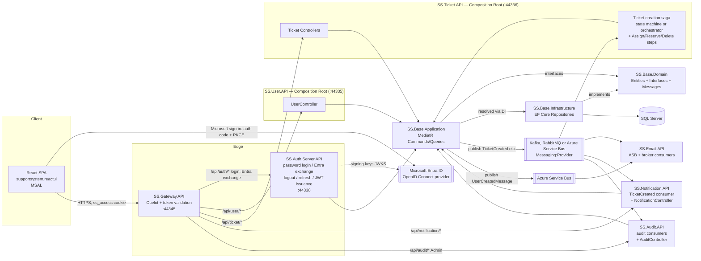
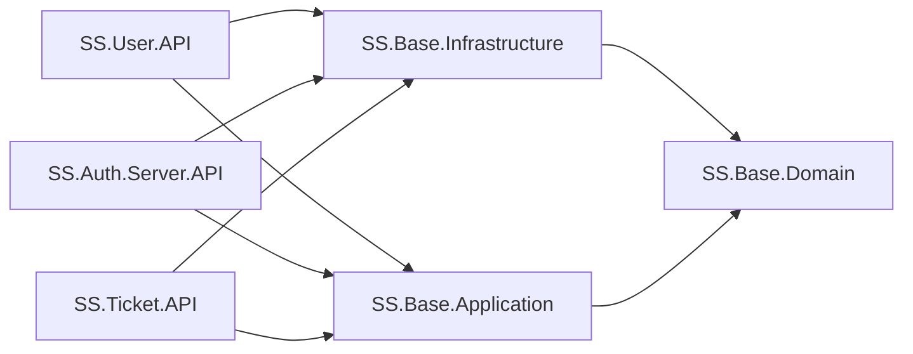

# Support System — Architecture

This system follows **Clean Architecture** for its core business logic (users, tickets), fronted by a set of thin ASP.NET Core edge services and a React SPA. The goal of the layering is: business rules (Domain) know nothing about the database, the web, or any framework; everything else depends inward on them.

## Solution map

| Project | Layer | Depends on | Purpose |
|---|---|---|---|
| `SS.Base.Domain` | **Domain** | *(nothing but MassTransit's abstractions — see note below)* | Entities, repository interfaces, the messaging ports (`IEventPublisher`, `IEventHandler<T>`), DTOs, cross-service message contracts. The center of the system. |
| `SS.Base.Application` | **Application** | `SS.Base.Domain`, `SS.Base.Messaging` | Use cases: MediatR commands/queries + handlers (CQRS), the broker-neutral message handlers (saga steps, notification, audit), the ticket-creation saga in two forms (MassTransit state machine for RabbitMQ, `TicketCreationOrchestrator` for Kafka) and the MassTransit consumers. Orchestrates domain objects via repository interfaces it doesn't implement. |
| `SS.Base.Infrastructure` | **Infrastructure** | `SS.Base.Domain` | EF Core `DbContext`, repository implementations, `IUnitOfWork`, migrations. Implements the interfaces Domain declares, including saga-state persistence. |
| `SS.User.API` | **Presentation** (composition root) | `SS.Base.Application`, `SS.Base.Infrastructure` | Owns `UserController` (user profiles: `me`, `fetchuser`, `createuser`). `/api/user/me` validates the caller's Support System token itself. |
| `SS.Ticket.API` | **Presentation** (composition root) | `SS.Base.Application`, `SS.Base.Infrastructure`, `SS.Base.Messaging` | Owns `TicketController`/`TicketUpdateController`, plus the ticket-creation saga on the selected broker (see below). |
| `SS.Notification.API` | **Presentation** (composition root) | `SS.Base.Application`, `SS.Base.Infrastructure`, `SS.Base.Messaging` | Owns in-app notifications: consumes `TicketCreated` (writes a `Notification` row) and serves `NotificationController` (`/api/notification/*`). |
| `SS.Audit.API` | **Presentation** (composition root) | `SS.Base.Application`, `SS.Base.Infrastructure`, `SS.Base.Messaging`, `SS.Base.Authentication` | Append-only audit trail built from bus messages (`AuditLogs` table); Admin-only `AuditController` (`/api/audit/*`). |
| `SS.Auth.Server.API` | **Presentation** (composition root) | `SS.Base.Application`, `SS.Base.Infrastructure` | Owns every session (see [Authentication](#authentication)): checks email/password or exchanges a Microsoft Entra ID access token, stores/rotates/revokes refresh tokens and issues HS256 JWTs with the role from the `Users` table — all in-process via the Application handlers, no calls to `SS.User.API`. |
| `SS.Gateway.API` | Edge service | *(none — Ocelot only)* | Ocelot reverse proxy (`ocelot.json`). Single entry point for the frontend; validates the Support System token (either sign-in option) on protected routes before forwarding to `SS.User.API`/`SS.Ticket.API`. |
| `SS.Base.Authentication` | Cross-cutting | *(none — ASP.NET Core JwtBearer only)* | Shared token setup: `AddSupportSystemAuthentication` (Gateway, User API — the Support System token) and `AddEntraIdTokenValidation` (Auth Server — the Entra token it exchanges) — see [Authentication](#authentication). |
| `SS.Email.API` | Edge service | `SS.Base.Domain`, `SS.Base.Messaging` | Standalone worker that drains an Azure Service Bus queue (user-created emails) **and** consumes the ticket-creation messages (ticket-received / ticket-creation-failed emails) on the selected broker. Decoupled from the rest of the system by messaging, not by reference. |
| `SS.Base.Messaging` | Cross-cutting | `SS.Base.Domain` | The broker switch (`AddSupportSystemMessaging`, `Messaging:Provider`): Kafka (Confluent.Kafka, the default), RabbitMQ (MassTransit) and Azure Service Bus (Azure.Messaging.ServiceBus) behind `IEventPublisher`/`IEventHandler<T>` — see [Messaging providers](#messaging-providers). |
| `SS.Base.Observability` | Cross-cutting | *(none — ASP.NET Core + OpenTelemetry only)* | Shared logging/tracing/metrics setup (`AddSupportSystemObservability`) referenced by every .NET host — see [Observability](#observability). Knows nothing about the business layers. |
| `supportsystem.reactui` | Client | *(HTTP only)* | React 18 + Redux Toolkit SPA. Signs users in with email/password or Microsoft Entra ID (MSAL, authorization code + PKCE); calls only the Gateway. |

> `SS.Base.Domain` referencing `MassTransit.Abstractions` is a deliberate, narrow exception to "zero dependencies": MassTransit's saga state machine requires the persisted saga-state class to implement its `SagaStateMachineInstance` marker interface, and that class needs to live somewhere Infrastructure can map it without Infrastructure depending on Application — Domain is the natural home, same as any other persisted entity.



## The dependency rule



`SS.Base.Domain` has no project references onto Application or Infrastructure — it's pure C# (entities, `Role`/`TicketStatus`/`TicketVisibility` enums, `I*Repository` interfaces, `IUnitOfWork`, message contracts). Both `SS.Base.Application` and `SS.Base.Infrastructure` reference *only* `SS.Base.Domain`, never each other. `SS.User.API`, `SS.Ticket.API` and `SS.Auth.Server.API` are each a composition root wiring both together (`ApplicationStartup.AddApplicationServices` + `Infrastructure.DependencyInjection.AddInfrastructureServices`, called from their respective `Program.cs`) — Users, Tickets and sign-in are separate deployable services. They still share one SQL Server database/schema and one `MSSQLDbContext`/migration history — this is a host-process split, not a database-per-service split.

## Layer details

### Domain — `SS.Base.Domain`
- `Entities/`: `User`, `UserProfile`, `Ticket`, `TicketUpdate`, `TicketLog`, `RefreshToken`, `Notification` (with `SourceEventId` for de-duplication), `RoundRobinCursor`, `TicketCreationSagaState`, `AuditLog`, `Permission`/`RolePermission`/`UserPermission`, plus enums (`Role`, `TicketStatus`, `TicketVisibility`).
- `Interfaces/Repository/`: `IGenericRepository<T>` (now including `RemoveAsync`), `IUserRepository` (including `GetNextAgentForAssignmentAsync`, the round-robin engineer picker), `ITicketRepository`, `ITicketUpdateRepository`, `IRefreshTokenRepository`, `INotificationRepository`, `IAuditLogRepository`, `ITicketCreationSagaRepository`, `IUnitOfWork` — the ports Application codes against and Infrastructure implements.
- `Interfaces/Messaging/`: `IEventPublisher` (publish to whichever broker is selected, with an optional partition key), `IEventHandler<T>` + `EventContext` (handle one message type, whatever broker delivered it), `ITicketMessage` (every ticket message exposes `TicketId`). The messaging equivalent of the repository ports — `SS.Base.Messaging` implements them per broker.
- `Messages/Ticket/`: the ticket-creation saga's cross-service contracts — `TicketCreated`, `AssignEngineerCommand`/`EngineerAssigned`/`AssignEngineerFailed`, `ReserveSlaCommand`/`SlaReserved`, `DeleteTicketCommand` (compensation), `SendTicketCreationFailedEmail` (compensation). Referenced by `SS.Ticket.API`, `SS.Notification.API`, `SS.Audit.API` (via Application) and `SS.Email.API` (direct reference, same as `UserCreatedMessage`).
- `Dto/`, `Email/`: transport-shape objects (e.g. `UserCreatedMessage` sent over the service bus).

### Application — `SS.Base.Application`
CQRS via MediatR: one folder per use case under `Commands/<Aggregate>/<UseCase>/` and `Queries/<Aggregate>/<UseCase>/`, each with a `*Command`/`*Query` (the `IRequest`) and a `*Handler` (the `IRequestHandler`).

- User: `CreateUser`, `ValidateUser`, `LoginSuccess` (persists a new `RefreshToken` on login), `LogOut` (revokes a `RefreshToken`), `TokenRefresh` (validates + rotates a `RefreshToken`), `GetUserByEmail`, `UpdateUserRole`.
- Ticket: `CreateTicket` (publishes `TicketCreated` via `IEventPublisher` after saving, keyed by ticket id, starting the saga below), `AddTicketUpdate`, `ModifyTicketUpdate`, `UpdateTicketStatus`, `GetTicketById`.
- Notification: `GetNotificationsByUser`. Audit: `GetAuditLogs`.
- `Events/AzureServiceBusQueueSender.cs`: publishes domain events (e.g. user-created) onto Azure Service Bus rather than calling `SS.Email.API` directly.
- `EventHandlers/`: the broker-neutral message handlers (`IEventHandler<T>`) — `AssignEngineerHandler`, `ReserveSlaHandler`, `DeleteTicketHandler` (saga steps), `CreateNotificationHandler`, `AuditEventHandler<T>`. They take repositories and `IEventPublisher` via DI, same constructor-injection style as the command Handlers, and are idempotent (at-least-once delivery).
- `Sagas/TicketCreationStateMachine.cs`: a `MassTransitStateMachine<TicketCreationSagaState>` orchestrating ticket creation over RabbitMQ; `Sagas/TicketCreationOrchestrator.cs`: the same workflow as plain `IEventHandler`s for Kafka and Azure Service Bus — see [Ticket-creation saga](#ticket-creation-saga) below.
- `Consumers/`: `AssignEngineerConsumer`, `ReserveSlaConsumer`, `CreateNotificationConsumer`, `DeleteTicketConsumer`, `AuditConsumer<T>` — thin MassTransit `IConsumer<T>` adapters (RabbitMQ only) that hand the message to the matching handler above. They keep their class names, so the RabbitMQ queue names are unchanged.
- `ApplicationStartup.cs`: DI extension (`AddApplicationServices`) — registers MediatR handlers scanned from this assembly, `IPasswordHasher<User>`, and the queue sender. This is the only place Application registers itself; it takes no dependency on Infrastructure. (Handlers, consumers and the saga are registered by the host that runs them, through `AddSupportSystemMessaging`.)

Handlers and consumers depend only on the Domain repository interfaces (e.g. `TokenRefreshHandler` takes `IRefreshTokenRepository`, `IUserRepository`, `IUnitOfWork`; `AssignEngineerConsumer` takes `ITicketRepository`, `IUserRepository`, `IUnitOfWork`) — never on `SS.Base.Infrastructure` types directly.

### Infrastructure — `SS.Base.Infrastructure`
- `Persistance/MSSQL/MSSQLDbContext.cs`: EF Core context, including the `TicketCreationSagaState` mapping MassTransit's EF Core saga repository persists against.
- `Persistance/MSSQL/Repositories/`: `UserRepository`, `TicketRepository`, `TicketUpdateRepository`, `RefreshTokenRepository`, `NotificationRepository`, `AuditLogRepository`, `TicketCreationSagaRepository`, `UnitOfWork` — implement the Domain interfaces against EF Core.
- `Migrations/`: EF Core migration history (SQL Server).
- `DependencyInjection.cs`: DI extension (`AddInfrastructureServices`) — registers the `DbContext` (SQL Server, connection string from config) and every repository/`IUnitOfWork` implementation.

### Presentation / composition roots — `SS.User.API`, `SS.Ticket.API` and `SS.Auth.Server.API`
- `SS.User.API/Controllers/UserController.cs` (thin — deserialize request, `_mediator.Send(...)`, return the result).
- `SS.Auth.Server.API/Controllers/AuthController.cs`: every Support System session. `login` (email/password) and `entra` (Microsoft sign-in: validates the Entra access token, then `GetUserByEmailQuery`) start one; `login`/`entra`/`logout`/`refresh-token` send `ValidateUserQuery`/`LoginSuccessCommand`/`LogOutCommand`/`TokenRefreshCommand` through MediatR, then sign the JWT with `Jwt:SigningKey` (`GenerateJwtToken`). It never publishes messages, so `Program.cs` registers a no-op `IEventPublisher` (`AddNoOpEventPublisher`) only to satisfy `CreateTicketHandler` (picked up by the MediatR scan) — sign-in does not depend on any broker.
- `SS.Ticket.API/Controllers/TicketController.cs`, `TicketUpdateController.cs` — same thin-controller style. `Program.cs` additionally calls `AddSupportSystemMessaging(...)`: the orchestrator + saga steps for Kafka, and (in `ForRabbitMq`) the MassTransit state machine (EF Core-persisted) and consumers for RabbitMQ.
- `SS.Notification.API/Controllers/NotificationController.cs` (moved from the Ticket API) and `SS.Audit.API/Controllers/AuditController.cs` (`[Authorize(Roles = "Admin")]`: `GET /api/audit/recent`, `GET /api/audit/ticket/{ticketId}`); both hosts also subscribe their handlers through `AddSupportSystemMessaging`.
- `SS.User.API` registers the publisher only (`AddSupportSystemMessaging` with no subscriptions).
- All of them call `AddApplicationServices` + `AddInfrastructureServices` — each is a place in the solution where Application and Infrastructure are both referenced and wired together.

### Edge services (outside the Clean Architecture core)
These are intentionally **not** part of the layered core — they have no project references to Domain/Application/Infrastructure and talk to the composition roots purely over HTTP or messaging, so they can be deployed, scaled, and reasoned about independently:

- **`SS.Gateway.API`**: Ocelot-based reverse proxy (`ocelot.json`). Single public entry point (`:44345`) for the SPA. Validates the Support System token (`ss_access` cookie, `Jwt:SigningKey`) on `/api/user/*`, `/api/ticket/*`, `/api/ticketupdate/*` and `/api/notification/*` before forwarding to `:44335` (User) or `:44336` (Ticket); `/api/auth/*` routes are unauthenticated (that's where a client with an expired/no token needs to reach). See [Authentication](#authentication). Rate-limits every `/api/*` request with counters in Redis before it reaches Ocelot — see [Rate limiting](#rate-limiting).
- **`SS.Email.API`**: Azure Service Bus consumer (user-created emails, existing) **and** ticket-creation email handlers (`TicketCreatedEmailHandler`, `TicketCreationFailedEmailHandler`; with RabbitMQ through `TicketCreatedEmailConsumer`/`TicketCreationFailedEmailConsumer`). Reacts to events published by `SS.Base.Application` — a messaging seam, not a Clean Architecture layer.

### Client — `supportsystem.reactui`
React 18 + Redux Toolkit, talking only to the Gateway (`https://localhost:44345/api`):
- `src/auth/session.js`: the Support System session through the Auth Server — the tokens are HttpOnly cookies the code never sees; password login, the Microsoft token exchange, single-flight refresh, logout, and the CSRF header (`X-Requested-With`) every call carries.
- `src/auth/authConfig.js`: the MSAL `PublicClientApplication` (Microsoft Entra ID, authorization code + PKCE), configured at runtime from `config.js`. Used only to sign in to (and out of) Microsoft; the "Sign in with Microsoft" button is shown only when it is configured.
- `src/index.js`: before the first render, completes a Microsoft sign-in redirect (`completeMicrosoftSignIn` → `/api/auth/entra`) and restores the session.
- `src/features/authSlice.js`: `loginUser` (password), `loginWithMicrosoft`, `completeMicrosoftSignIn`, `logoutUser`, `restoreSession` (start-up: asks `/api/user/me` whether the cookies still make a session) and the signed-in user's Support System profile (`fetchUser` → `/api/user/me`).
- `src/api/axios.js`: shared axios instance — on a 401, refreshes the session cookies once and retries.
- `src/components/`, `src/pages/`: screens (ticket list/create/detail, user list/create). `TicketCreateForm.js` no longer sends `AssignedTo` — engineer assignment is now server/saga-driven.
- `src/app/store.js`: Redux store.

## Request flow examples

**Login (email/password):**
`SPA → Gateway (/api/auth/login, no auth) → Auth Server → ValidateUserHandler → UserRepository → SQL Server`. On success the Auth Server sends `LoginSuccessCommand` (→ `LoginSuccessHandler`, persists a `RefreshToken`), mints a JWT, and sets both as HttpOnly cookies (`ss_access`, `ss_refresh` — see [Authentication](#authentication)); the response body carries no token.

**Login (Microsoft Entra ID):**
`SPA "Sign in with Microsoft" → Microsoft Entra ID sign-in page → redirect back to the SPA with an authorization code → MSAL redeems it (with the PKCE verifier) for an ID token and an access token → SPA → Gateway (/api/auth/entra, no gateway auth; Entra token as Bearer header) → Auth Server` validates the Entra token (`AddEntraIdTokenValidation`), finds the `Users` row by the token's email (`GetUserByEmailQuery`) and starts the same session as a password login: `LoginSuccessCommand`, JWT with the row's role, HttpOnly cookies. An Entra account without a matching `Users` row gets a 403, shown on the login page.

Either way the SPA then calls `GET /api/user/me` (Gateway → User API), which reads the email claim from the token and returns the user's Support System `UserId`/`Role`/name.

**Token refresh (either sign-in option):**
An API call returns 401 (access cookie expired) → `SPA → Gateway (/api/auth/refresh-token, no auth — the browser sends the ss_refresh cookie) → Auth Server → TokenRefreshHandler` looks the `RefreshToken` up by its value, validates and rotates it via `IRefreshTokenRepository`/`IUnitOfWork`, returns the user's email/role → Auth Server mints a new JWT and sets fresh cookies → SPA's axios interceptor retries the original request. The same happens at start-up when only the refresh cookie is left.

### Ticket-creation saga

`SPA (Bearer JWT) → Gateway → Ticket API → TicketController → CreateTicketCommand → CreateTicketHandler` persists the `Ticket` (unassigned — `AssignedTo`/`ResponseDueDate`/`ResolutionDueDate` are all nullable until the saga fills them in) and publishes `TicketCreated` to the selected broker (see [Messaging providers](#messaging-providers)). Four things react to it independently:

1. **The saga** (in `SS.Ticket.API` — `TicketCreationStateMachine` with RabbitMQ, `TicketCreationOrchestrator` with Kafka and Azure Service Bus; same states, same `TicketCreationSagaStates` table) starts, transitions to `AssigningEngineer`, and publishes `AssignEngineerCommand`.
   - `AssignEngineerConsumer` round-robins over `Role.Agent` users (`IUserRepository.GetNextAgentForAssignmentAsync`, cursor persisted in `RoundRobinCursor`). No agents available → publishes `AssignEngineerFailed`; otherwise sets `Ticket.AssignedTo` and publishes `EngineerAssigned`.
   - On `EngineerAssigned`, the saga transitions to `ReservingSla` and publishes `ReserveSlaCommand`. `ReserveSlaConsumer` applies a priority-based SLA policy (High: 4h response/1d resolution, Medium: 1d/3d, Low: 2d/7d), sets `Ticket.Status = InProgress` ("Ticket Ready"), and publishes `SlaReserved` — the saga finalizes.
   - On `AssignEngineerFailed` (compensation path): the saga publishes `DeleteTicketCommand` (→ `DeleteTicketConsumer` removes the ticket) and `SendTicketCreationFailedEmail`, then finalizes as failed. Only this explicit "no agents available" business failure triggers compensation — infrastructure-level consumer faults fall back to MassTransit's default retry/error-queue behavior.
2. **`CreateNotificationHandler`** (in `SS.Notification.API`) reacts to `TicketCreated` directly, writing a `Notification` row for the ticket's creator — not gated by the saga.
3. **`TicketCreatedEmailHandler`** (in `SS.Email.API`) reacts to `TicketCreated` directly, emailing the creator a "ticket received" message.
4. **`AuditEventHandler<T>`** (in `SS.Audit.API`) records `TicketCreated`, `EngineerAssigned`, `AssignEngineerFailed` and `SlaReserved` in `AuditLogs`.

Every subscriber gets its own copy of each message: with RabbitMQ through MassTransit's convention-based topology (one fan-out exchange per message type, one queue per consumer), with Kafka through one topic per message type and one consumer group per handler.

## Messaging providers

Which broker carries the messages is a per-deployment setting, `Messaging:Provider` (env `Messaging__Provider`; docker-compose `MESSAGING_PROVIDER`, k8s/Helm `MESSAGING_PROVIDER` / `config.messagingProvider`). Every provider stays in the code; the setting only picks which one `AddSupportSystemMessaging` wires up at startup.

| Provider | Status | Publish | Consume | Saga | Retries / dead letters |
|---|---|---|---|---|---|
| `Kafka` (default) | implemented | `KafkaEventPublisher` (Confluent.Kafka): topic `support.<message-type>`, key = ticket id, JSON value, id/type/`traceparent` headers | `KafkaConsumerWorker` per handler, consumer group `<service>.<handler>`, offset committed after success | `TicketCreationOrchestrator` | N retries with backoff, then `<topic>.dlt` |
| `RabbitMq` | implemented (the original) | MassTransit `Publish` | MassTransit consumers → same handlers | `TicketCreationStateMachine` | MassTransit retry / `_error` queues |
| `AzureServiceBus` | implemented | `AzureServiceBusEventPublisher` (Azure.Messaging.ServiceBus): same topic names, MessageId = event id, CorrelationId = ticket id | `AzureServiceBusProcessorWorker` per handler, subscription `<service>.<handler>`, peek-lock, Complete after success | `TicketCreationOrchestrator` | Abandon with back-off, MaxDeliveryCount, built-in `$DeadLetterQueue` |

Business code depends only on `IEventPublisher`/`IEventHandler<T>` (Domain ports), so a handler is written once and runs on every provider. Each host lists its handlers with `Subscribe<TMessage, THandler>()` (Kafka and Azure Service Bus) and its MassTransit registrations with `ForRabbitMq(...)`. Delivery is at-least-once everywhere, so handlers de-duplicate on `EventContext.EventId` (`AuditLogs.EventId` and `Notifications.SourceEventId` are unique). The learning guides with runnable experiments are [docs/messaging/KAFKA.md](docs/messaging/KAFKA.md) and [docs/messaging/AZURE-SERVICE-BUS.md](docs/messaging/AZURE-SERVICE-BUS.md). Locally, Service Bus runs on Microsoft's emulator (`docker compose --profile servicebus`, entities in `servicebus-emulator/Config.json`); in Azure it needs a Standard-tier namespace.

## Authentication

There are two sign-in options, side by side on the login page, and both end in the **same Support System session**:

1. **Email/password** — `SS.Auth.Server.API` checks the password against the `Users` table.
2. **Microsoft Entra ID** — **OpenID Connect** sign-in with Entra ID as the identity provider. The SPA is a public client using the authorization code flow with **PKCE** (no client secret in the browser). Entra only proves *who* the user is: the SPA sends the Entra **access token** (OAuth 2.0, scope `access_as_user`) once to `POST /api/auth/entra`, and the Auth Server exchanges it for a Support System session.

Either way the Auth Server issues an **HS256 JWT** (claims `email`, `UserId`, `role`; 1 h) plus a rotating refresh token (7 days), both as **HttpOnly cookies**, signed with `Jwt:SigningKey`. The **role always comes from the `Users` table**, never from Entra ID, so role checks (`[Authorize(Roles = "Admin")]`, `RoleClaimType = "role"`) work the same for both options. The gateway and the APIs never see an Entra token.

| Piece | Role | How |
|---|---|---|
| React SPA | OAuth *public client* | `auth/session.js` (no token handling — the browser sends the cookies). Microsoft sign-in: `@azure/msal-browser` gets an **ID token** (who signed in — OpenID Connect) and an **access token** for the API scope, which `index.js` exchanges right after the redirect. |
| `SS.Auth.Server.API` | token exchange + issuer | `AddEntraIdTokenValidation`: `EntraId` `JwtBearer` scheme (`Authority = https://login.microsoftonline.com/<tenant>/v2.0`: OpenID metadata + signing keys; validates signature, issuer, audience, lifetime), used only by `[Authorize(AuthenticationSchemes = "EntraId")] POST /api/auth/entra`. |
| `SS.Base.Authentication` | shared validation | `AddSupportSystemAuthentication`: one `Bearer` `JwtBearer` scheme for the Support System token, from the `ss_access` cookie (or an `Authorization` header): `Jwt:SigningKey`, lifetime. |
| `SS.Gateway.API` | resource server | Ocelot routes with `AuthenticationProviderKey: "Bearer"` reject requests without a valid Support System token. |
| `SS.User.API` | resource server | Same validation, used by `[Authorize] GET /api/user/me` so the user's identity comes from the token, not from the request. |
| SQL `Users` table | authorization | Both options identify the user by email; the Support System `Role` (Admin/Agent/Customer) comes from the database. |

A user removed from the `Users` table can't refresh any more (`TokenRefreshHandler` looks the user up), but disabling someone **in Entra ID** doesn't end a Support System session that was already started — it lasts until its refresh token expires (7 days) or the user signs out.

### Session cookies

| Cookie | Holds | Path | Lifetime | Flags |
|---|---|---|---|---|
| `ss_access` | the JWT | `/api` (every API call) | 1 h | `HttpOnly; Secure; SameSite=Strict` |
| `ss_refresh` | the refresh token | `/api/auth` (Auth Server only) | 7 days | `HttpOnly; Secure; SameSite=Strict` |

Written and deleted by `SS.Auth.Server.API` (`AuthCookies` in `SS.Base.Authentication`); no response body carries a token, so no JavaScript — including an injected script — can read or exfiltrate one. This relies on the SPA and the API sharing one origin (dev proxy, docker-compose nginx, k8s ingress). `Secure` cookies still work on `http://localhost`; anywhere else the app is served over HTTPS.

**CSRF:** because the browser attaches the cookies by itself, the services accept `ss_access` — and the Auth Server its endpoints — only on requests carrying `X-Requested-With: XMLHttpRequest`, which the SPA's axios instances always send and a page on another site can't add. `SameSite=Strict` additionally keeps browsers from attaching the cookies to cross-site requests.

**Rotation:** refresh tokens are single-use. If two tabs refresh at the same instant, the second one's (already used) token is rejected and that tab shows the login page.

The Entra side needs no shared secret (only the tenant id and the API's client id, both public, used by the Auth Server). `Jwt:SigningKey` is shared between the Auth Server, Gateway and User API: `appsettings.json` holds a development default, override it per environment with `Jwt__SigningKey` (k8s/Helm: `JWT_SIGNING_KEY` in the `supportsystem-secrets` Secret / `secrets.jwtSigningKey`). Leave the setting out rather than empty — an empty env var would override the default with `""`.

### One-time setup in the Azure portal (Microsoft Entra ID option)

Without these settings the app still runs with the email/password option only (no "Sign in with Microsoft" button).

1. **API app registration** — *Microsoft Entra ID → App registrations → New registration*, name `Support System API`, single tenant.
   - *Expose an API*: set the Application ID URI (`api://<api-client-id>`) and add a scope `access_as_user` (who can consent: Admins and users).
   - *Manifest*: set `"requestedAccessTokenVersion": 2`.
   - *Token configuration → Add optional claim → Access → `email`* (needed for guest accounts; members already have `preferred_username`).
2. **SPA app registration** — name `Support System SPA`, single tenant.
   - *Authentication → Add a platform → Single-page application*, redirect URIs (trailing slash included): `http://localhost:3000/` (`npm start`), `http://localhost/` (docker-compose), `https://<your-ingress-host>/` (AKS).
   - *API permissions → Add → My APIs → Support System API → `access_as_user`*, then *Grant admin consent* (optional; otherwise users consent on first sign-in).
3. **Users** — every person who signs in needs a `Users` row whose `PrimaryEmail` equals their Entra sign-in name / email. The role comes from that row; no app roles are needed in Entra ID.

### Configuration

| Where | Settings |
|---|---|
| Auth Server + Gateway + User API | `Jwt__SigningKey` (Support System tokens; same value in all three) |
| Auth Server (`appsettings.json` → `AzureAd`) | `AzureAd__TenantId`, `AzureAd__ClientId` (= API client id); optional `AzureAd__Audience` (defaults to `api://<ClientId>`) |
| React container (`config.js`, written by `40-app-config.sh`) | `ENTRA_TENANT_ID`, `ENTRA_SPA_CLIENT_ID`, `ENTRA_API_SCOPE` (`api://<api-client-id>/access_as_user`) |
| `npm start` | the same three as `REACT_APP_ENTRA_*` in `supportsystem.reactui/.env.local` |
| docker-compose | shell / `.env`: `ENTRA_TENANT_ID`, `ENTRA_API_CLIENT_ID`, `ENTRA_SPA_CLIENT_ID`, `ENTRA_API_SCOPE` |
| k8s / Helm | ConfigMap keys `ENTRA_*` / chart values `entra.*` |

**HTTPS is required outside localhost:** Entra ID only redirects to `https://` URIs (except `localhost`), and PKCE needs the browser's Web Crypto API, which only exists in a secure context. On AKS, serve the ingress on a host name with TLS (`ingress.host` + `ingress.tls`) — sign-in will not work over `http://<load-balancer-ip>`.

## Rate limiting

`SS.Gateway.API` limits every `/api/*` request **before** Ocelot forwards it (`SS.Gateway.API/RateLimiting/`), so a throttled client never costs the downstream APIs or the database anything. Counters live in **Redis**, so the limit is shared by all gateway replicas (the HPA runs 2–10) instead of each pod allowing its own budget.

| Policy | Routes | Counted per | Default |
|---|---|---|---|
| `auth` | `/api/auth/*` (login, entra, refresh-token, logout) | client IP — slows down password guessing / credential stuffing | 20 requests / 60 s |
| `api` | every other `/api/*` route | signed-in user (the token's `UserId` claim); client IP for anonymous or invalid tokens | 300 requests / 60 s |

**Algorithm — sliding-window counter.** Each client has one Redis counter per fixed window (`ss:ratelimit:{policy:client}:<window#>`, expiring after two windows). A request counts against *current window + the still-overlapping share of the previous window*, which avoids the 2× burst a plain fixed window allows at the boundary, at the cost of only two keys per client. Check and increment run in **one Lua script**, so concurrent requests on different pods can't both slip under the limit. The `{…}` hash tag keeps both keys in one slot, so it also works on a Redis Cluster / Azure Cache for Redis cluster tier.

**Responses.** Allowed requests get `X-RateLimit-Limit` / `X-RateLimit-Remaining`; over the limit the gateway answers **`429 Too Many Requests`** with `Retry-After` (seconds) and an RFC 7807 problem body, and logs a warning.

**Client IP.** The gateway always sits behind a reverse proxy (nginx in docker-compose, ingress-nginx on AKS), so `UseForwardedHeaders` takes the client IP from the last `X-Forwarded-For` entry — the one the proxy appended.

**Fails open.** If Redis is down or slower than the 500 ms timeout, requests are let through (no limiting), a warning is logged at most every 30 s, and the request is counted as `result="unavailable"`. Redis being down never takes the API down, and the gateway's readiness doesn't depend on it.

**Metrics.** `ss_gateway_rate_limit_requests_total{policy="auth|api", result="allowed|rejected|unavailable"}` on `/metrics` (meter `SS.Gateway.RateLimiting`). For example, `sum(rate(ss_gateway_rate_limit_requests_total{result="rejected"}[5m])) by (policy)`.

**Configuration** (gateway `appsettings.json`, override with env vars):

| Setting | Env var | docker-compose | k8s / Helm |
|---|---|---|---|
| `Redis:ConnectionString` (empty = limiting off) | `Redis__ConnectionString` | `redis` service | Secret key `REDIS_CONNECTION_STRING` / `secrets.redisConnectionString` (in-cluster `redis` Deployment by default; point it at Azure Cache for Redis with `redis.enabled: false`) |
| `RateLimiting:Enabled`, `RateLimiting:Auth:*`, `RateLimiting:Api:*` (`PermitLimit`, `WindowSeconds`) | `RateLimiting__Api__PermitLimit`, … | appsettings defaults | ConfigMap `RATE_LIMIT_*` / chart values `rateLimiting.*` |

The in-cluster Redis has no persistence on purpose: the counters are short-lived, so a restart only resets the current window.

## Observability

Logging, distributed tracing and metrics use **OpenTelemetry**, exported to **Azure Application Insights** via Microsoft's Azure Monitor OpenTelemetry Distro (`Azure.Monitor.OpenTelemetry.AspNetCore`). Every .NET host calls one extension from `SS.Base.Observability`:

```csharp
builder.AddSupportSystemObservability("ss-ticket-api");   // service name = Application Map node
```

| Signal | Where it goes | What produces it |
|---|---|---|
| **Logs** | Always stdout (`docker logs` / `kubectl logs`); also Application Insights `traces` when configured | `ILogger<T>` everywhere — consumers, saga, handlers, `EmailService`, `AuthController`; plus `LoggingBehavior` (a MediatR pipeline behavior that logs every command/query name + duration + failures, never the payload) |
| **Traces** | Application Insights `requests`/`dependencies` | ASP.NET Core, `HttpClient` (Auth → User API, Ocelot → downstream), SQL Client, MassTransit (`AddSource("MassTransit")`: publish/send/consume/saga spans over RabbitMQ) and Kafka (`AddSource("SS.Base.Messaging")`: publish/process spans) |
| **Metrics** | Always Prometheus `/metrics` (`UseSupportSystemMetrics`, scraped by Azure Managed Prometheus → Grafana); also Application Insights `customMetrics` when configured | .NET 8 built-in meters (HTTP server/Kestrel/routing/HttpClient), runtime instrumentation (GC, thread pool, exceptions) + MassTransit meter |
| **Browser** | Application Insights (role `ss-react-ui`) | `src/telemetry/logger.js` (Application Insights JS SDK): page views, `/api` dependency calls, unhandled exceptions, `ErrorBoundary` render errors, `logger.*` calls |

**Correlation.** W3C Trace Context (`traceparent`) is propagated automatically: the browser SDK stamps `/api` calls, ASP.NET Core/`HttpClient` continue it through Gateway → Auth/User/Ticket API, and MassTransit (RabbitMQ) or `SS.Base.Messaging` (Kafka `traceparent` header) carries it across the broker into the saga steps and the email, notification and audit services. So one "create ticket" click is one end-to-end transaction in Application Insights, and every stdout log line carries the same `TraceId` in its scope. Each response also has an `X-Trace-Id` header (`UseTraceIdResponseHeader`) for looking a failed call up directly.

**Configuration** (all via standard config/env vars, no rebuild needed):

- `APPLICATIONINSIGHTS_CONNECTION_STRING` — empty/unset (the default) disables export entirely; logs still go to stdout. Set via the `supportsystem-secrets` Secret in k8s, a shell var / `.env` for docker-compose, and read by the React container at start-up into `config.js` (`docker-entrypoint.d/40-app-config.sh`).
- `Logging__Console__FormatterName` — `simple` (readable, default for local runs) or `json` (one structured line per entry; set in docker-compose and the k8s ConfigMap as `LOG_CONSOLE_FORMAT`).
- `Logging__LogLevel__Default` and per-category levels in `appsettings.json` (`Microsoft.EntityFrameworkCore`, `Ocelot`, `System.Net.Http.HttpClient` default to `Warning` so SQL text and per-request proxy chatter don't flood logs or the Application Insights bill).
- `/health/*` probe and `/metrics` scrape requests are excluded from tracing.
- `Metrics__Port` — when set, `/metrics` is only answered on that port (k8s: `9464`, bound via `Kestrel__Endpoints__Metrics__Url` and not exposed by any Service, so metrics aren't public through the Ingress). Unset (local runs, docker-compose), it's served on the normal app port.

**What is deliberately not logged:** request bodies, passwords, JWTs/refresh tokens, and email addresses (users are identified by `UserId`). The browser logger drops properties named like `password`/`token`/`authorization`/`secret`, and the JS SDK is configured not to capture request/response headers.

## Known gaps / technical debt

- The password login's `Jwt:SigningKey` has a development default committed in `appsettings.json` (the value that used to be hardcoded) — every real deployment must override it with a secret, then rotate it.
- `ValidateUserHandler` compares passwords in plain text (the `IPasswordHasher<User>` check is commented out).
- After a Microsoft sign-in, MSAL's cache (ID/access/refresh token) stays in `sessionStorage` so sign-out can also end the Entra session. The gateway no longer accepts those tokens, but scripts on the page can read them; it's cleared whenever there's no Support System session.
- `SS.Ticket.API` trusts the Gateway's token check rather than validating the token itself, and still takes `CreatedBy` from the request body instead of the token.
- No `Application`-layer input validation pipeline (e.g. FluentValidation + MediatR behavior) yet — the `Validators/` folder exists but is empty.
- `SS.Gateway.API/ocelot.json` still has leftover routes pointing at `localhost:3000` (`/`, `/static/{everything}`, `/user/{everything}`, `/ticket/{everything}`) that predate the current API-only gateway usage.
- The in-cluster/docker-compose Redis (rate-limit counters only) has no password or TLS; use Azure Cache for Redis (`ssl=True,password=…`) or add `requirepass` + a NetworkPolicy for production. docker-compose also publishes the gateway directly on `:5145`, where a client could forge `X-Forwarded-For` to dodge the per-IP limit — only the ingress path is trustworthy.
- RabbitMQ has no auth/TLS hardening for local dev (`guest`/`guest`, matching the broker's own defaults) — fine for `docker-compose.rabbitmq.yml` locally, not production-ready as-is.
- Kafka runs as one broker without authentication, TLS or persistence (docker-compose and k8s/Helm) — a learning setup. `Messaging:Kafka` already takes SASL/TLS settings for a managed cluster.
- The Service Bus emulator has no management API, so its topics/subscriptions are listed by hand in `servicebus-emulator/Config.json` and must be kept in sync with the hosts' `Subscribe` calls; the readiness check is skipped there (and with any policy lacking *Manage* rights).
- No transactional outbox: `CreateTicketHandler` saves the ticket, then publishes. If the publish fails the ticket exists without a saga (same as before with RabbitMQ). The fix is an outbox table written in the same transaction and relayed to the broker.
- A rare duplicate email is possible on redelivery — `SS.Email.API` has no database to de-duplicate against.
